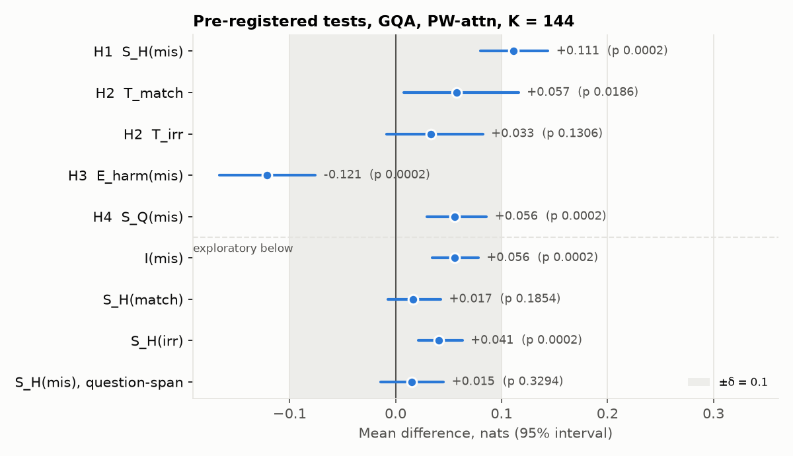
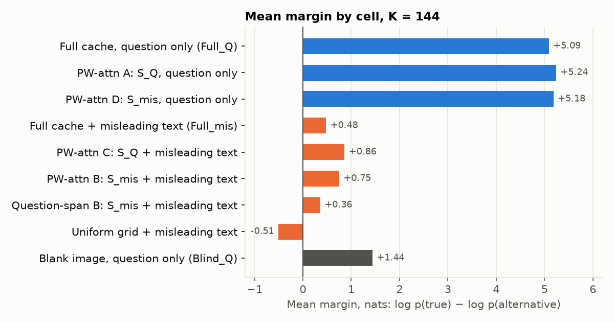
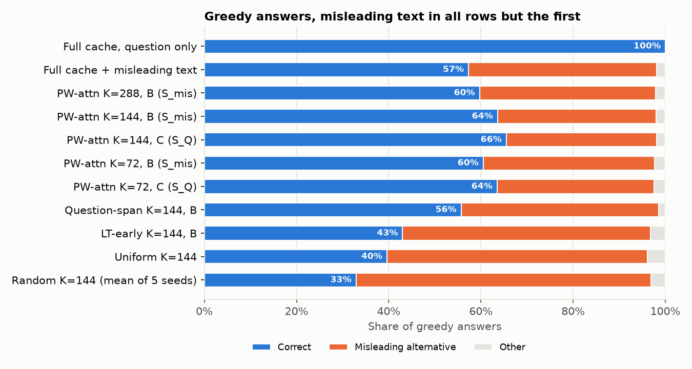
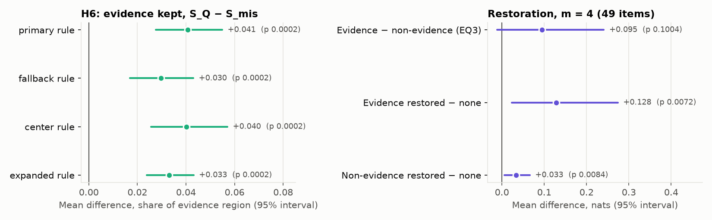
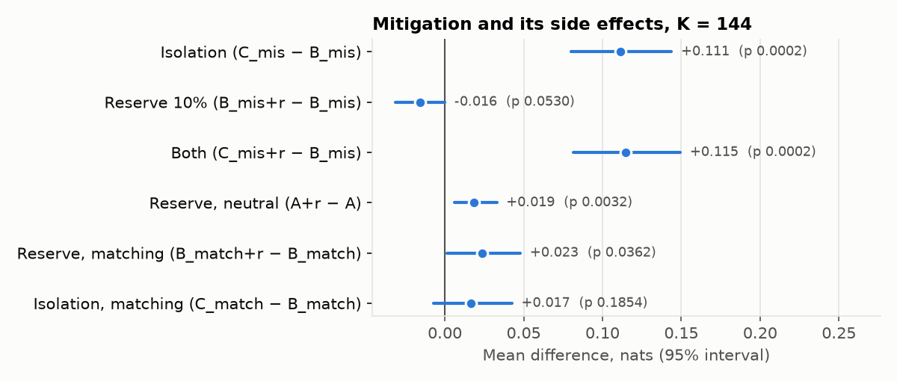
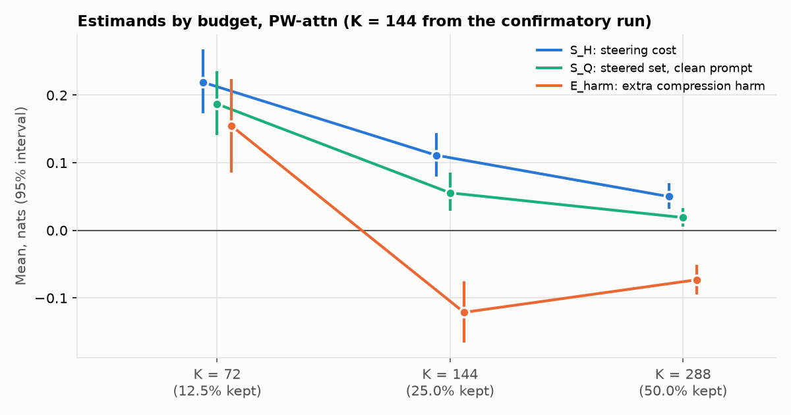
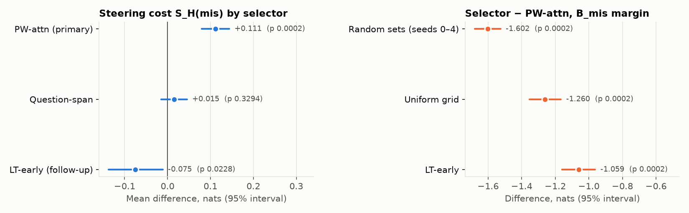

# Status report, 12 November 2026

## The study
Does unreliable text steer which visual entries LLaVA-1.5-7B keeps when its cache is compressed?

The prompt includes a misleading description. We compare two kept sets under that same prompt:
- **B:** visual entries chosen with the description in view (S_mis).
- **C:** visual entries chosen from the question only (S_Q).

**Main measure:** S_H^(mis) = margin(C) − margin(B), where the margin is log p(true answer) − log p(misleading alternative), in nats. A positive value means the description steered selection toward worse entries.

**Other estimands** (all at K = 144 of 576 visual entries unless noted):
- **T_match, T_irr:** S_H^(mis) minus S_H under a matching or an irrelevant description. They ask whether the effect comes from false text specifically.
- **S_Q^(mis):** margin(A) − margin(D). This is the steered set's cost when the prompt is clean.
- **E_harm^(mis):** how much more compression hurts with the misleading description than without it.
- **I^(mis):** S_H − S_Q.

## Where we are
| Stage | Status |
| --- | --- |
| 1–6. Pipeline, datasets, GPU validation, development pilots, prompt v3.1, builder fixes | Done |
| 6b. Pre-registration (`PREREG.md`), stage-1 freeze, GQA screen | Done |
| 6c. Amendment 1 (blind filter), new GQA screen, verification to 1,000 passes | Done |
| 6d. GQA stage-3 freeze, confirmatory run, pre-registered analysis | **Done** (11 November) |
| 6e. GQA follow-ups (PREREG 2.4) | **Done** (11 November): budgets, LT-early, random seeds, restoration |
| 7. TextVQA: screen, verification, freeze, run, joint analysis | **Next** |
| Second model, Qwen2.5-VL | Parked |

## GQA confirmatory data
| | GQA |
| --- | ---: |
| Confirmatory pool screened | 9,209 |
| Eligible: Full_Q correct with a positive margin, and **not** answerable from a blank image (amendment 1) | 4,586 (50%) |
| Main set: first 1,000 eligible items that passed hand verification, in manifest order | 1,000 items on 708 images |
| Control subset (all descriptions) / grounding subset (evidence box) | 300 / 300 |

**Checks on the run:**
- Full_Q stayed eligible on all 1,000 items.
- Blind_Q became eligible on 0.
- No answers were truncated.

**Procedural notes:**
- The verification decisions had 61 gaps: eligible items never decided. They were filled before the freeze, with bad items failed with a reason rather than skipped.
- The run folder also held 9 item files outside the frozen main set, left over from an earlier `confirm` call. They were moved out unopened before the analysis. *TODO: record how they arose.*

## Confirmatory results (GQA)
These are the pre-registered results. All tests are two-sided, with an image-clustered bootstrap (10,000 resamples). The Holm decisions are formally **pending** until TextVQA runs. But p = 0.0002 is the smallest p this bootstrap can produce, so H1, H3 and H4 will survive Holm whatever TextVQA shows. T_irr (p = 0.13) cannot survive. Only T_match depends on TextVQA.

| Hypothesis | Estimate (nats) | 95% interval | p | Reading |
| --- | ---: | --- | ---: | --- |
| **H1** S_H^(mis) | **+0.111** | [+0.080, +0.144] | 0.0002 | Misleading text steers selection, and it costs margin |
| H2 T_match | +0.057 | [+0.008, +0.116] | 0.019 | Steering is larger than with matching text |
| H2 T_irr | +0.033 | [−0.009, +0.082] | 0.13 | Can't be told apart from irrelevant text |
| **H3** E_harm^(mis) | **−0.121** | [−0.166, −0.076] | 0.0002 | **Opposite to the prediction** at K = 144 |
| H4 S_Q^(mis) | +0.056 | [+0.029, +0.086] | 0.0002 | The steered set is worse even with a clean prompt |
| Equivalence (δ = 0.10) | 90% CI [+0.085, +0.139] | | | Not negligible by the pre-registered bar |

**Exploratory results:**
- I^(mis) = +0.056.
- S_H^(irr) = +0.041: irrelevant text steers a little.
- S_H^(match) = +0.017 (n.s.).
- The question-span selector isn't steered (+0.015, n.s.).
- S_H keeps the same direction and significance under all three alternative margin forms.

### Scale: steering is small next to the text's direct effect

- The misleading description costs about **4.6 nats** directly, through decoding: Full_Q is 5.09 and Full_mis is 0.48.
- Selection steering adds 0.11 on top of that.
- Compressing slightly *raises* the margin under misleading text: B_mis (0.75) and C_mis (0.86) are both above Full_mis (0.48). That is why E_harm is negative at K = 144.

### Answers

- With the full cache and misleading text, the model gives the misleading alternative 41% of the time.
- Selecting with the question only (C) raises correct answers from 63.6% to 65.5% (+1.9 points, p = 0.003).

### Mechanism

- **H6:** the steered set keeps 3–4 points less of the annotated evidence region, under all four mapping rules.
- **H5:** the more the description changes the kept set, the larger the harm. The slope is +2.65 per unit of (1 − Jaccard), SE 0.52. The mean Jaccard(S_Q, S_mis) is 0.86.

### Mitigation

- Isolation, meaning selecting with the question only, recovers the full +0.11.
- The 10% coverage reserve does nothing for the misleading text (−0.016, n.s.). It slightly helps neutral and matching prompts.
- The uniform grid is far worse than PW-attn (−1.26).

## Follow-ups (GQA, not confirmatory)
These are PREREG 2.4's follow-ups, run on the same 1,000 items. They are descriptive and carry no claims. The consistency checks were perfect: the K = 144 kept sets matched the confirmatory run 100%, and the rerun B_mis margin matched exactly.

### Budget: steering grows as the budget shrinks

| K | S_H^(mis) | S_Q^(mis) | E_harm^(mis) | Uniform − B_mis |
| ---: | ---: | ---: | ---: | ---: |
| 288 | +0.050 | +0.019 | −0.073 | −0.54 |
| 144 | +0.111 | +0.056 | −0.121 | −1.26 |
| 72 | **+0.219** | +0.187 | **+0.155** | −2.36 |

- S_H roughly doubles each time the budget halves.
- **E_harm changes sign at K = 72.** At a tight budget, misleading text *does* make compression worse, as H3 originally predicted. The negative confirmatory result holds only at generous budgets.

### Selectors: the steering is specific to PW-attn, and attention still pays

- **Steering:**
  - PW-attn: +0.111.
  - Question-span: +0.015 (n.s.).
  - LT-early: −0.075.

  Only PW-attn, whose attention window comes after the description, is steered toward worse entries.
- **Selection quality under misleading text, relative to PW-attn B_mis:**
  - random sets: −1.60;
  - uniform grid: −1.26;
  - LT-early: −1.06.

  Steered PW-attn is still far better than text-agnostic selection. Its steering costs 0.11; attention selection itself gains about 1.6.

### Oracle restoration (EQ3): too few items
Restoration puts back m entries that the description pushed out of S_Q, either evidence entries or non-evidence entries as the control.
- **Qualifying items:** only 49 of 300 at m = 4, and 8 at m = 8.
- **At m = 4:**
  - Restoring evidence gains +0.128 [+0.023, +0.274].
  - Restoring non-evidence gains +0.033.
  - The difference, +0.095 [−0.011, +0.241], is inconclusive.
- **At m = 8:** there are too few items to read.

## Reading of the GQA results
- **The description steers PW-attn's selection toward worse patches.** The mechanism holds together: harm grows with how much the kept set changes, less evidence is kept, and the effect grows as K shrinks.
- **The size:** small at K = 144 (0.11 nats, about 2 points of correct answers), substantial at K = 72.
- **It is small next to** the description's direct effect on decoding (4.6 nats) and next to the value of attention-based selection (about 1.6 nats over random).
- **Practical implication:** keep attention-based selection, but select with the question only (isolation). That costs nothing measurable with matching text.

## Development pilots (9 November, no claims)
These are kept for the record.
- **GQA v3.1 (150 items):** S_H^(mis) = +0.09 [+0.02, +0.18]; E_harm = −0.21. The confirmatory run agrees in direction on both.
- **TextVQA v3.1 (188 items):**
  - S_H^(mis) = −0.01 (no steering).
  - E_harm = +0.45, but positive for every description.
  - The model mostly resists the misleading text (2% alternative answers).
- Template v3.1 ("Unverified description, possibly wrong:") cut GQA's alternative-answer rate with the full cache from 99% to 46% in development. The confirmatory run gave 41%.

## Qwen2.5-VL-7B
Parked. Compressed replay differs from the reference by 0.038 nats, against a 0.01 limit, because of its bf16 numbers. The code is kept.

## Next
1. **TextVQA, under the frozen protocol:** screen, verify to 1,000 passes, freeze, run, then the joint `confirm-report`. That finalises the Holm decisions.
2. **Record the 9 extra run files** in the plan.
3. **Possible further follow-ups, each defined before it is run:**
   - mitigation at K = 72;
   - a fused selector;
   - a hint-masked probe;
   - PW-attn window and layer ablations;
   - matching and irrelevant text at K = 72;
   - restoration with a smaller m;
   - free analyses of which patches get pushed out and which items are steered.

Figures: `documents/figures/`. Rebuild them with `uv run python scripts/report_figures.py`. The follow-up numbers are transcribed in `documents/figures/followup_gqa.json` from the server's follow-up report.
